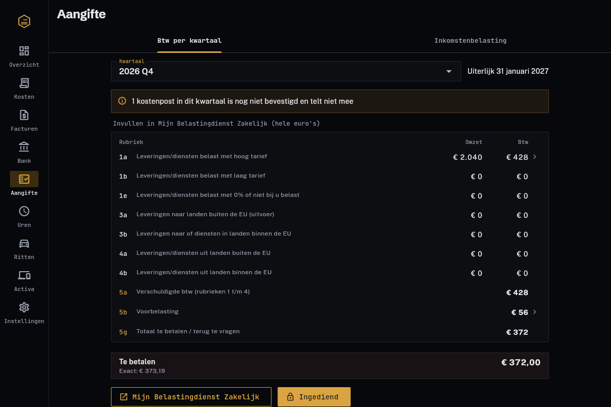
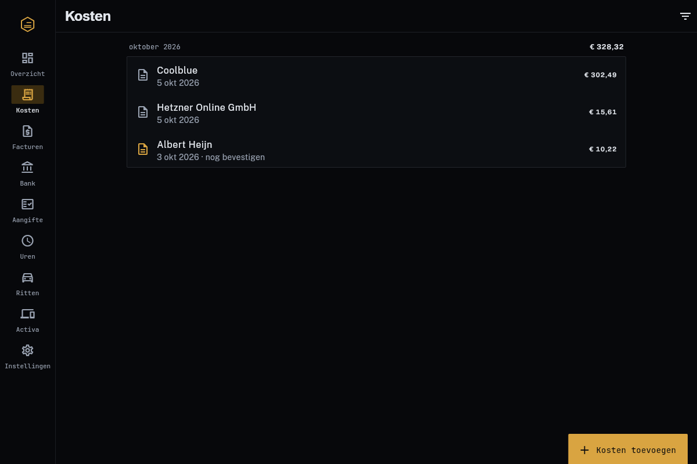

<a id="readme-top"></a>

[![Stargazers][stars-shield]][stars-url]
[![Issues][issues-shield]][issues-url]
[![License][license-shield]][license-url]

<br />
<div align="center">
  <a href="https://github.com/Not-Bad-Company/ledgerbee">
    
  </a>

<h3 align="center">Ledgerbee</h3>

  <p align="center">
    Free, self-hosted bookkeeping for freelancers and one-person businesses.
    <br />
    Scan receipts, send invoices and quotes, import the bank, and have your tax figures ready when they're due. The Netherlands is supported first.
    <br />
    <br />
    <a href="https://github.com/Not-Bad-Company/ledgerbee/issues/new?labels=bug">Report a bug</a>
    &middot;
    <a href="https://github.com/Not-Bad-Company/ledgerbee/issues/new?labels=enhancement">Request a feature</a>
  </p>
</div>

<details>
  <summary>Table of contents</summary>
  <ol>
    <li><a href="#about-the-project">About the project</a><ul><li><a href="#built-with">Built with</a></li></ul></li>
    <li><a href="#getting-started">Getting started</a><ul><li><a href="#prerequisites">Prerequisites</a></li><li><a href="#installation">Installation</a></li></ul></li>
    <li><a href="#usage">Usage</a></li>
    <li><a href="#roadmap">Roadmap</a></li>
    <li><a href="#contributing">Contributing</a></li>
    <li><a href="#license">License</a></li>
    <li><a href="#contact">Contact</a></li>
    <li><a href="#acknowledgments">Acknowledgments</a></li>
  </ol>
</details>

## About the project

![Ledgerbee overview][product-screenshot]

I run a one-person company and didn't want to pay a monthly fee for bookkeeping software, so I built my own. Ledgerbee covers what a freelancer needs every day and at every tax deadline. Tax rules live in a module per country; the Netherlands (btw and inkomstenbelasting) is the first, and the app itself is in Dutch for now.

- **Receipts:** photograph a bon and the phone reads it (on the device, offline). Share a PDF invoice from your mail and the server reads its text layer. You check the draft and confirm.
- **Invoices and quotes:** numbered without gaps, with every field the Belastingdienst requires, a scan-to-pay QR code, e-mail delivery, reminders for late payers and credit invoices for corrections. An accepted quote becomes an invoice in one tap.
- **Bank:** import a CSV or CAMT.053 export from ING, Rabobank, ABN AMRO, Knab or bunq. Payments are matched to invoices and receipts, and payments without a receipt are listed.
- **Btw-aangifte:** every rubriek from 1a to 5g for a quarter, in whole euros the way the form wants them. Tap a rubriek to see the invoices and costs behind it before you file.
- **Inkomstenbelasting:** winst, urencriterium, zelfstandigenaftrek, startersaftrek, MKB-winstvrijstelling, KIA, depreciation and kilometres, from tax tables that are updated each year.
- **Reminders:** phone notifications and a daily e-mail before every deadline.

Your data stays on your own server. There is one user per install, and a filed quarter is locked so the numbers you filed can't change underneath you.

 

### Built with

[![Rust][rust-shield]][rust-url]
[![SQLite][sqlite-shield]][sqlite-url]
[![Flutter][flutter-shield]][flutter-url]
[![Kotlin][kotlin-shield]][kotlin-url]

The server is a single Rust binary (axum, rusqlite) that holds all data and all tax logic. The app is Flutter for Android and Linux, with Google ML Kit for on-device text recognition and an offline outbox for receipts scanned without signal.

## Getting started

### Prerequisites

- A machine that stays on: a Raspberry Pi is plenty.
- Rust (the toolchain is pinned in `server/rust-toolchain.toml`), `pdftotext` from poppler-utils, and `sqlite3`.
- Flutter, to build the app.
- Optional: a [Brevo](https://www.brevo.com) account for sending invoices and reminder e-mails. The free tier is enough.

### Installation

1. Clone the repo and configure the server:
   ```sh
   git clone https://github.com/Not-Bad-Company/ledgerbee.git
   cd ledgerbee/server
   cp .env.example .env    # set BOEK_SECRET to the output of: openssl rand -hex 32
   cargo build --release
   ```
2. Create your account. It asks for a password and prints a QR code for your authenticator app plus ten recovery codes:
   ```sh
   ./target/release/boekhouding create-user you@example.nl
   ```
3. Run it as a service. Adjust the user and paths in `deploy/*.service` first:
   ```sh
   sudo cp ../deploy/boekhouding.service ../deploy/boekhouding-backup.* /etc/systemd/system/
   sudo systemctl enable --now boekhouding boekhouding-backup.timer
   ```
4. Keep it off the open internet. Either bind `BOEK_BIND` to your [Tailscale](https://tailscale.com) address, or keep `127.0.0.1` and put it behind a reverse proxy or tunnel with https. The app refuses plain http to anything outside your own network.
5. Build and install the app:
   ```sh
   cd ../app
   flutter build apk --release          # Android: install build/app/outputs/flutter-apk/app-release.apk
   flutter build linux --release        # Linux: build/linux/x64/release/bundle/
   ```
6. Log in with the server address, your e-mail, password and a code from the authenticator. The overview asks for your company details first; they appear on every invoice.

## Usage

- **When you pay:** tap *Kosten toevoegen*, photograph the bon or pick the PDF, check the draft, confirm. From another app, share the file to Ledgerbee.
- **Once a month:** import the bank export, link the suggestions and find the receipts that are missing.
- **Each quarter** (deadline: the last day of the following month): open *Aangifte → Btw*, check the rubrieken, copy the whole-euro figures into Mijn Belastingdienst Zakelijk, pay, then mark the quarter *Ingediend*.
- **Before 1 May:** open *Aangifte → Inkomstenbelasting* for last year, export the year as a zip of CSVs and attachments if your accountant wants it, and file.
- **Every January:** add the new year's figures to `server/src/tax/mod.rs`. A missing year falls back to the newest one, and the report says so.

Backups run nightly: a consistent SQLite snapshot plus the attachments, kept for eight years (the bewaarplicht is seven). Set `BOEK_BACKUP_REMOTE` to an rclone remote for an off-site copy.

## Roadmap

- [x] Receipts by camera, file or share sheet
- [x] Btw-aangifte with the sources behind each rubriek
- [x] Invoices with scan-to-pay, reminders and credit invoices
- [x] Quotes that turn into an invoice
- [ ] Recurring invoices
- [ ] Receipts forwarded by e-mail
- [ ] UBL / Peppol export
- [ ] English interface and more countries
- [ ] Web version of the app

The full list is in [docs/ROADMAP.md](docs/ROADMAP.md). See the [open issues](https://github.com/Not-Bad-Company/ledgerbee/issues) for known bugs and requests.

## Contributing

Bug reports are the most useful contribution, especially wrong tax figures: say which rubriek or line, what you expected and why. Pull requests are welcome too. Read [CONTRIBUTING.md](CONTRIBUTING.md) first, because contributions come with a licence grant.

1. Fork the project
2. Create a branch (`git checkout -b feature/quotes`)
3. Commit your changes
4. Push the branch and open a pull request

## License

Ledgerbee is free to use, change and self-host, for yourself or your own business, under the [Elastic License 2.0](LICENSE). You may not offer it to others as a hosted or managed service.

## Contact

Daan Hessen, [Not Bad Company](https://notbadcompany.com) &middot; contact@notbadcompany.com

Project link: [github.com/Not-Bad-Company/ledgerbee](https://github.com/Not-Bad-Company/ledgerbee)

## Acknowledgments

- [Best-README-Template](https://github.com/othneildrew/Best-README-Template), which this README follows
- [Google ML Kit](https://developers.google.com/ml-kit/vision/text-recognition/v2) for on-device text recognition
- [printpdf](https://github.com/fschutt/printpdf) and [qrcode](https://github.com/kennytm/qrcode-rust) for the invoice PDF
- [Schibsted Grotesk](https://github.com/schibsted/schibsted-grotesk), [Public Sans](https://public-sans.digital.gov/) and [JetBrains Mono](https://www.jetbrains.com/lp/mono/)

<p align="right">(<a href="#readme-top">back to top</a>)</p>

[stars-shield]: https://img.shields.io/github/stars/Not-Bad-Company/ledgerbee.svg?style=for-the-badge
[stars-url]: https://github.com/Not-Bad-Company/ledgerbee/stargazers
[issues-shield]: https://img.shields.io/github/issues/Not-Bad-Company/ledgerbee.svg?style=for-the-badge
[issues-url]: https://github.com/Not-Bad-Company/ledgerbee/issues
[license-shield]: https://img.shields.io/badge/license-Elastic%202.0-D9A441.svg?style=for-the-badge
[license-url]: https://github.com/Not-Bad-Company/ledgerbee/blob/main/LICENSE
[product-screenshot]: docs/images/overzicht.png
[rust-shield]: https://img.shields.io/badge/Rust-000000?style=for-the-badge&logo=rust&logoColor=white
[rust-url]: https://www.rust-lang.org/
[sqlite-shield]: https://img.shields.io/badge/SQLite-003B57?style=for-the-badge&logo=sqlite&logoColor=white
[sqlite-url]: https://www.sqlite.org/
[flutter-shield]: https://img.shields.io/badge/Flutter-02569B?style=for-the-badge&logo=flutter&logoColor=white
[flutter-url]: https://flutter.dev/
[kotlin-shield]: https://img.shields.io/badge/Kotlin-7F52FF?style=for-the-badge&logo=kotlin&logoColor=white
[kotlin-url]: https://kotlinlang.org/
